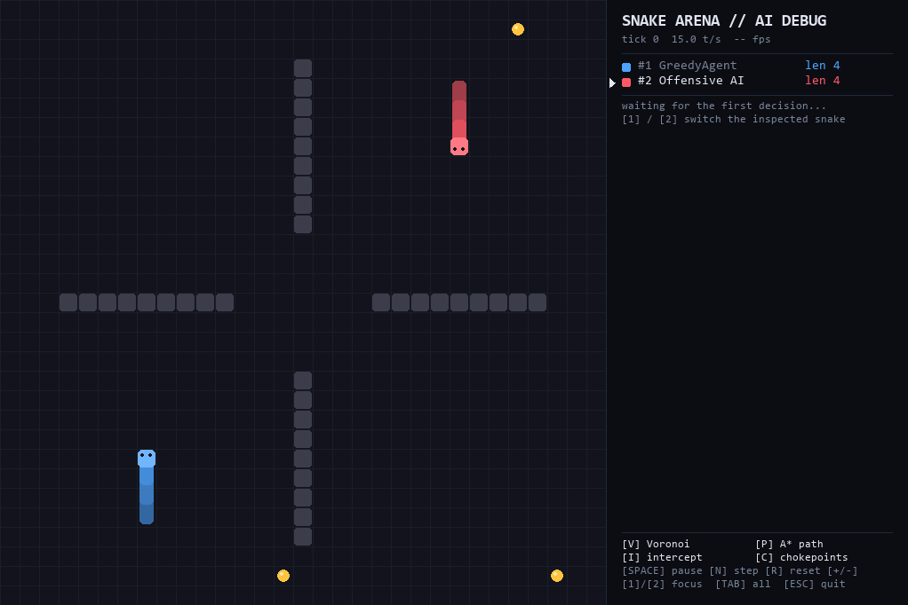
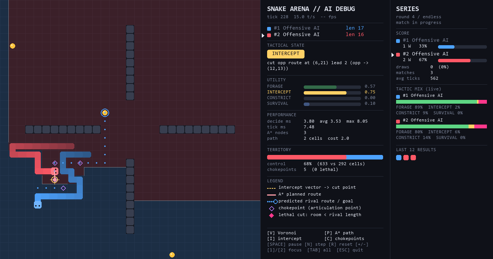
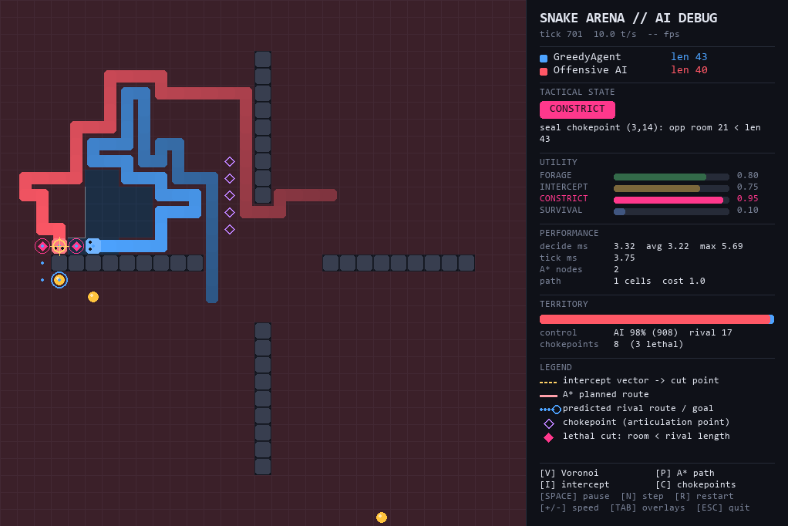
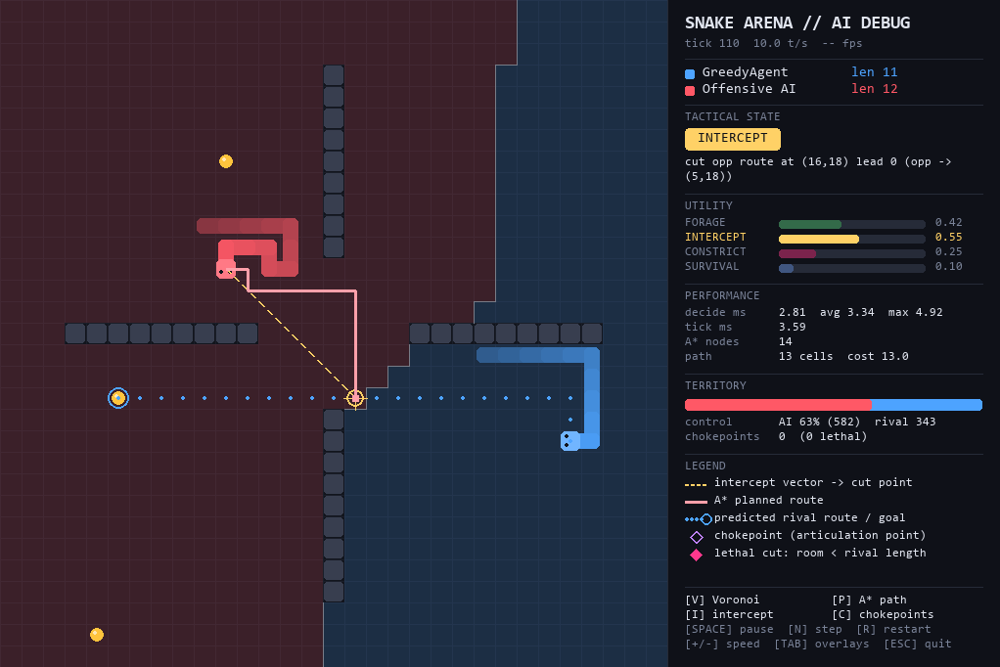

# Snake Arena - Adversarial AI Engine


[English](README.md) · **Español**

Snake asimétrico en tiempo real: un jugador humano contra una IA que no solo come y sobrevive, sino que **ataca**. Estrangula el espacio del rival, se interpone en su ruta hacia la comida y sella cuellos de botella para dejarlo encerrado con menos celdas libres que su propia longitud. Un **modo espectador** enfrenta a dos agentes autónomos en series de partidas que se reinician solas, con marcador persistente.

La idea central del proyecto es la **explicabilidad algorítmica**. Cada tick, la IA publica un `DecisionTrace` con lo que percibió y lo que pretende hacer. La vista lo dibuja como capas de depuración: partición de Voronoi, ruta A\*, vector de intercepción, puntos de articulación y un HUD con las utilidades de cada modo táctico.



*Partida real (semilla 2) grabada sin ventana con `snake-arena record --seed 2 --highlight-lethal --output assets/showcase.gif`. La IA roja gana con un corte letal en el tick 310 y el vídeo repite ese momento antes del resultado final.*

---

## Índice

1. [Arquitectura del sistema](#1-arquitectura-del-sistema)
2. [Módulo algorítmico y modelado matemático](#2-módulo-algorítmico-y-modelado-matemático)
3. [Benchmarks y rendimiento](#3-benchmarks-y-rendimiento)
4. [Capa de inspección: debug overlays](#4-capa-de-inspección-debug-overlays)
5. [Grabación y exportación de repeticiones](#5-grabación-y-exportación-de-repeticiones)
6. [Trade-offs y decisiones de diseño](#6-trade-offs-y-decisiones-de-diseño)
7. [Instalación y reproducibilidad](#7-instalación-y-reproducibilidad)

---

## 1. Arquitectura del sistema

### Capas y dirección de dependencias

Las dependencias apuntan siempre hacia el núcleo. `core` no importa nada del proyecto. `pygame` solo aparece en `view/` y en `record/`, que reutiliza el mismo `SceneRenderer` para dibujar fotogramas fuera de pantalla. Pillow e imageio-ffmpeg son opcionales y solo se cargan al exportar.

```
+--------------------------------------------------------------------------------+
|                               snake_arena                                      |
|                                                                                |
|   +---------------------+        +----------------------+                      |
|   |   core/  (puro)     |<-------|  analysis/           |                      |
|   |---------------------|        |----------------------|                      |
|   | Grid  Snake         |        | release_times        |                      |
|   | GameState (frozen)  |        | reach_times  voronoi |                      |
|   | rules.step()        |        | astar  Tarjan        |                      |
|   | spawn_food(rng)     |        +----------------------+                      |
|   +---------------------+                   ^                                  |
|        ^          ^                         | features                         |
|        |          |                +----------------------+                    |
|        |          +----------------|  agents/ (Strategy)  |                    |
|        |           GameState       |----------------------|                    |
|        |           (read-only)     | BaseAgent            |                    |
|        |                           | AggressiveAI (Utility|                    |
|   +---------------------+          |   + perception)      |                    |
|   | engine/             |--------->| HumanController      |                    |
|   |---------------------| decide() | GreedyAgent          |                    |
|   | SimulationEngine    |<---------+----------------------+                    |
|   | tick determinista   | Decision{direction, trace}                           |
|   | métricas por agente |                                                      |
|   | MatchSeries         |  rondas encadenadas, re-seed, pausa post-partida     |
|   | SeriesStats         |  marcador (también lo usa el benchmark)              |
|   +---------------------+                                                      |
|        |                                                                       |
|        | TickRecord{state, decisions, compute_ms, tick_ms}   (solo lectura)    |
|        v                                                                       |
|   +------------------------------------------------------+                     |
|   | view/  (pygame-ce)                                   |                     |
|   | SceneRenderer: board + banner + HUD (+ serie)        |<------+             |
|   | BoardRenderer: capas alpha cacheadas + overlays      |       |             |
|   | HudPanel: razonamiento del agente con foco [1]/[2]   |       |             |
|   | SeriesPanel: marcador, tácticas, últimos resultados  |       |             |
|   | ArenaApp: ventana, tick fijo desacoplado de los FPS  |       |             |
|   +------------------------------------------------------+       |             |
|                                                                  |             |
|   +------------------------------------------------------+       |             |
|   | record/  (sin ventana)                               |-------+             |
|   | MatchRecorder: Surface fuera de pantalla -> bytes    |                     |
|   | FrameWriter: GifWriter (Pillow) | Mp4Writer (ffmpeg) |                     |
|   +------------------------------------------------------+                     |
+--------------------------------------------------------------------------------+
```

### Flujo de un tick

```
GameState_t --+--> agent_i.decide(state_t, i) ----------> Decision_i {direction, DecisionTrace}
              |        (el engine mide ms por agente)             |
              |                                                   v
              +--> rules.step(state_t, {i: direction_i}) --> TickResult {state', deaths, eaten}
                                                                  |
                         spawn_food(state', rng(seed)) <----------+
                                   |
                                   v
                              GameState_t+1 ---> TickRecord ---> View (renderiza, nunca escribe)
```

### Por qué el núcleo es headless y sin dependencias de renderizado

| Decisión | Beneficio |
|---|---|
| `GameState`, `Snake` y `Grid` son `@dataclass(frozen=True, slots=True)` | Ningún agente ni la vista pueden corromper el estado. Los snapshots se comparten sin copias defensivas y son *hashables*, así que sirven como clave de caché. |
| `rules.step(state, moves) -> TickResult` es una función pura | El mismo estado y los mismos movimientos dan siempre el mismo resultado. Las reglas de colisión se prueban con 16 tests sin abrir ninguna ventana. |
| La única aleatoriedad es `random.Random(seed)`, y vive en el engine | Cada partida se reproduce desde su semilla. El benchmark obtiene victorias, muertes y reparto de modos idénticos en cada ejecución; solo varían los tiempos. |
| `SimulationEngine` no importa `pygame` | Permite benchmarks de miles de ticks sin ventana, CI sin servidor gráfico y una prueba de humo de la vista con `SDL_VIDEODRIVER=dummy`. |
| El reloj del engine se puede inyectar (`clock=`) | La medición de latencia se prueba de forma determinista con un reloj falso. |
| Las celdas son índices planos `Cell = NewType("Cell", int)`, con tablas de movimiento y adyacencia precalculadas | El BFS y el A\* recorren enteros y tuplas precalculadas: nada de tuplas `(x, y)` ni comprobaciones de límites en el bucle interno. |

### Semántica del tick (reglas de combate)

- **Movimiento simultáneo.** Las colisiones se evalúan sobre el tablero ya movido, incluidos los cuerpos de serpientes que mueren en ese mismo tick. El resultado no depende del orden de proceso.
- **Crecimiento diferido.** Comer suma `pending_growth` y la cola se queda quieta en el tick siguiente. Al empezar cada tick ya se sabe qué colas se liberarán.
- **Choque frontal (*head-to-head*).** Gana la serpiente más larga según su longitud después del movimiento. Si miden lo mismo, mueren ambas. El cruce de cabezas (A entra en la celda de B y B en la de A) también cuenta como choque frontal.
- **Giro de 180°.** Se ignora y la serpiente mantiene su dirección.

### Estructura del repositorio

```
src/snake_arena/
  core/       grid.py  snake.py  state.py  rules.py           modelo de dominio y reglas puras
  analysis/   occupancy.py  flood.py  astar.py  articulation.py  algoritmos de grafos sin estado
  agents/     base.py  perception.py  aggressive.py  human.py  baseline.py
  engine/     config.py  simulation.py  series.py  bench.py   bucle determinista, series y benchmark
  view/       theme.py  board.py  hud.py  series_panel.py  scene.py  app.py   pygame-ce
  record/     writers.py  gif.py  mp4.py  recorder.py        exportación GIF/MP4 en streaming
  __main__.py                                                 CLI: play | watch | record | bench
tests/        105 tests (pytest) + support.py
docs/img/     capturas de partidas reales
assets/       showcase.gif / showcase.mp4 generados con `snake-arena record`
```

---

## 2. Módulo algorítmico y modelado matemático

Notación: $V$ son las celdas abiertas del tablero y $E \le 2V$ las aristas en vecindad 4. En la arena por defecto (31×31 con muros en cruz), $V = 925$.

### 2.1 Liberación temporal de segmentos corporales

Un cuerpo no es un muro permanente: cada segmento deja libre su celda al cabo de un número conocido de ticks. Para una serpiente de longitud $L$ con crecimiento pendiente $g$, el segmento de índice $k$ (con $k = 0$ en la cabeza) libera su celda en:

```math
\tau(c) = L - k + g, \qquad \tau(\text{libre}) = 0, \qquad \tau(\text{obstáculo}) = \infty
```

Una cabeza puede entrar en la celda $c$ en el instante $t$ si y solo si $t \ge \tau(c)$. Un test comprueba que este modelo coincide con `rules.step` en cada movimiento posible de una serpiente que persigue su cola, con y sin crecimiento pendiente (`test_release_times_agree_with_the_rules`).

`reach_times` es un BFS con `collections.deque` que solo relaja una arista cuando la celda de destino ya está libre al llegar: $O(V + E)$. Si una celda sigue ocupada, el BFS puede alcanzarla más tarde por un rodeo, cuando el segmento ya se haya ido.

### 2.2 Partición territorial: Voronoi BFS multifuente, $O(V + E)$

Las cabezas de las dos serpientes se expanden a la vez, por capas de tiempo, sobre el mismo modelo temporal. Si $d_i(c)$ es el tiempo de llegada de la serpiente $i$ a la celda $c$ (cada fuente puede empezar en un instante $s_i$ distinto):

```math
\text{owner}(c) =
\begin{cases}
i & \text{si } d_i(c) < d_j(c) \\
\arg\max_{\{i,j\}} L^{+} & \text{si } d_i(c) = d_j(c) \text{ y } L_i^{+} \ne L_j^{+} \\
\text{neutral} & \text{si } d_i(c) = d_j(c) \text{ y } L_i^{+} = L_j^{+}
\end{cases}
```

Aquí $L^{+}$ es `Snake.next_length`, la longitud después del siguiente movimiento. El desempate reproduce la regla de choque frontal: si las dos llegan a la vez a una celda, la más larga ganaría el choque, así que la celda es suya. La métrica que se muestra en el HUD es la cuota de control $\rho = |V_{IA}| / (|V_{IA}| + |V_{rival}|)$.

### 2.3 Búsqueda de rutas: A\* ponderado sobre el grafo temporal

```math
f(n) = g(n) + w \cdot h(n), \qquad h = \text{Manhattan}, \qquad w = 1.25 \;\Rightarrow\; \text{coste} \le 1.25 \cdot \text{óptimo}
```

- **Coste de las aristas.** Es $1 + \text{penalización}(c)$. Cuando la IA **no** es más larga, las celdas a las que el rival puede llegar en el siguiente tick cuestan $+12$, y el anillo siguiente, donde el rival podría hacer una pinza, $+4$.
- **Llegada a la meta.** Se entra en la celda objetivo solo si $t \ge \tau(\text{meta})$. Así, perseguir la cola propia es un caso normal de A\*.
- **Telemetría** (`PathResult`): ruta, coste acumulado y `nodes_expanded`, también cuando no hay ruta. Un límite de expansiones acota el peor caso.
- **Desempate del heap.** Se ordena por $(f, h, \text{contador})$: prefiere los nodos más cercanos a la meta y garantiza el determinismo.

### 2.4 Puntos de articulación: Tarjan iterativo, $O(V + E)$

Sobre el grafo de celdas libres ahora mismo ($\tau(c) = 0$), se ejecuta un DFS de Tarjan **iterativo** con raíz en la cabeza del rival. Es iterativo para no chocar con el límite de recursión de CPython en tableros grandes. Para cada punto de articulación $v$, el DFS acumula el tamaño de los subárboles que quedarían separados de la raíz si se quitara $v$. El resultado es el espacio que le quedaría al rival si la IA sellara $v$:

```math
\text{cut\_area}(v) = (n - 1) - \sum_{\substack{c \,\in\, \text{hijos}(v) \\ \text{low}(c) \,\ge\, \text{disc}(v)}} |\text{subárbol}(c)|, \qquad n = |\text{componente de la raíz}| - 1
```

Todos los cortes se obtienen en **una sola pasada**, sin un flood fill por candidato.

¿Por qué cortes de vértice y no puentes? Un cuerpo ocupa celdas (vértices), no aristas. Además, cualquier puente que separe más de una celda tiene al menos un extremo que ya es punto de articulación, así que el análisis de vértices cubre los estrangulamientos que importan.

**Corte letal** (lo que activa `CONSTRICT` con utilidad 0,95). Un punto de articulación $v$ es un corte letal si cumple todo esto:

```math
\text{cut\_area}(v) < L_{rival} \;\wedge\; t_{IA}(v) \le 10 \;\wedge\; \big(t_{IA}(v) < t_{rival}(v) \;\vee\; (t_{IA}(v) = t_{rival}(v) \wedge L^{+}_{IA} > L^{+}_{rival})\big) \;\wedge\; \text{espacio}_{IA}(v) \ge L_{IA}
```

La última condición evita que la IA quede atrapada con el rival.

### 2.5 Intercepción predictiva

1. **Objetivo previsto del rival.** Es la comida alcanzable más cercana según $t_{rival}$. Si no hay ninguna, es la celda alcanzable más próxima al centro del tablero: se le bloquea el acceso al centro.
2. **Ruta prevista.** Se reconstruye hacia atrás desde los tiempos de llegada del BFS, sin guardar una tabla de padres.
3. **Punto de intercepción.** Es la celda más temprana de esa ruta en la que la IA llega primero, con ventaja $\text{lead}(c) = t_{rival}(c) - t_{IA}(c) \ge \lambda$, donde $\lambda = 0$ si la IA es más larga (acepta el choque frontal, que ganaría) y $\lambda = 1$ si no. Se prefieren los puntos de articulación.

### 2.6 Toma de decisiones: sistema de utilidades con histéresis

Cada tick, `perception.perceive()` calcula todas las métricas **una sola vez**. Con ellas se puntúan los cuatro modos tácticos y se elige el de mayor utilidad.

**Notación.** $L$ y $L_{rival}$ son las longitudes de la IA y del rival; $L^{+}$, la longitud tras el siguiente movimiento; $A$, el espacio que alcanza la IA; $T_{rival}$, el territorio de Voronoi del rival, y $\rho$, la cuota de control de la IA (sección 2.2). $\text{clamp}(x)$ recorta $x$ al intervalo $[0, 1]$, y $[P]$ vale 1 si la condición $P$ se cumple y 0 si no.

#### Señales auxiliares

```math
S = \text{clamp}\left(\frac{3L - A}{2L}\right) \qquad\qquad \text{calm} = 1 - S
```

$S$ es la urgencia de supervivencia: vale 0 mientras la IA dispone de al menos $3L$ celdas y llega a 1 cuando su espacio baja a $L$. El factor `calm` atenúa todos los modos ofensivos a medida que crece el peligro.

```math
h = \text{clamp}\left(\frac{L_{rival} - L + 3}{6}\right) \qquad\qquad r = \begin{cases} 1 & \text{si la IA gana la carrera hacia esa comida} \\ 0.5 & \text{si no} \end{cases}
```

$h$ es el hambre: crece cuanto más corta es la IA respecto al rival.

#### Utilidad de cada modo

```math
U_{\text{FORAGE}} = (0.35 + 0.45\,h) \cdot r \cdot \text{calm}
```

```math
U_{\text{INTERCEPT}} = \big(0.45 + 0.3\,[\text{corte en una articulación}] + 0.1\,[L^{+} > L^{+}_{rival}]\big) \cdot \text{calm}
```

```math
U_{\text{CONSTRICT}} = \begin{cases} 0.95 \cdot \text{calm} & \text{si hay corte letal} \\ 0.8 \cdot \text{clamp}\big(\max(\sigma,\ \delta)\big) \cdot \text{calm} & \text{si no} \end{cases}
```

```math
\sigma = \frac{4L_{rival} - T_{rival}}{3L_{rival}} \qquad\qquad \delta = \begin{cases} (\rho - 0.55) / 0.25 & \text{si } L^{+} > L^{+}_{rival} \\ 0 & \text{si no} \end{cases}
```

```math
U_{\text{SURVIVAL}} = \max(S,\ 0.1)
```

$\sigma$ mide la asfixia del rival: vale 0 cuando su territorio es de $4L_{rival}$ celdas y 1 cuando baja a $L_{rival}$. $\delta$ mide la dominancia: pasa de 0 a 1 cuando la cuota de control de la IA sube del 55 % al 80 %, y solo cuenta si la IA es más larga.

| Modo | Su utilidad es alta cuando… |
|---|---|
| `FORAGE` | la IA es más corta que el rival y llega antes que él a la comida |
| `INTERCEPT` | hay un punto de corte en la ruta prevista del rival, sobre todo si es un cuello de botella |
| `CONSTRICT` | existe un corte letal, el territorio del rival se reduce o la IA, más larga, domina el tablero |
| `SURVIVAL` | el espacio de la IA se acerca a su longitud; el mínimo de 0,1 garantiza siempre un plan de reserva |

El resultado es una personalidad asimétrica: con **desventaja de tamaño, la IA come**; **con ventaja, hostiga**; si detecta un **corte letal, estrangula**; y si su espacio se reduce, **persigue su cola**.

- **Histéresis.** Se mantiene el modo anterior mientras la diferencia con el mejor sea menor que 0,08. Esto evita que el modo oscile tick a tick y que el HUD parpadee.
- **Planificación por modo.**
  - `FORAGE`: A\* hacia la comida elegida.
  - `INTERCEPT`: A\* hacia el punto de intercepción.
  - `CONSTRICT`: A\* hacia el corte letal; si no lo hay, elige el movimiento que minimiza el espacio y el territorio del rival.
  - `SURVIVAL`: A\* hacia la propia cola; si no hay ruta, el movimiento con más espacio.
- **Filtro de seguridad por capas.** Veta la propuesta del modo si hace falta. El pool de movimientos es el primer nivel no vacío de esta lista:
  1. espacio suficiente y sin choque frontal desfavorable;
  2. espacio suficiente y distinto de la celda que se predice que tomará el rival;
  3. espacio suficiente;
  4. cualquier movimiento no letal.

  "Espacio suficiente" significa $A' \ge \min(L, \max A')$, así que la IA nunca entra en un hueco más pequeño que su cuerpo si existe una alternativa. Cada veto queda anotado en el `rationale` (`| safety -> DOWN`).

### 2.7 Coste por tick

| Paso | Operación | Complejidad |
|---|---|---|
| Liberación temporal | 1 pasada por los cuerpos | $O(V)$ |
| Alcance propio y del rival | 2 BFS temporales | $O(V + E)$ |
| Voronoi actual | 1 BFS multifuente | $O(V + E)$ |
| Cuellos de botella | 1 DFS de Tarjan | $O(V + E)$ |
| Evaluación de hasta 3 movimientos | 3 × (alcance + Voronoi + alcance del rival) | $9 \cdot O(V + E)$ |
| Comprobación de escape del corte letal | ≤ 3 BFS | $O(V + E)$ |
| Plan del modo | 1 A\* ponderado | $O(E \log V)$ |

En total son unas 15 pasadas lineales y un A\* por decisión, sobre $V = 925$ celdas.

---

## 3. Benchmarks y rendimiento

Condiciones: 20 partidas, `GreedyAgent` (azul) contra `Offensive AI` (roja), arena `cross` de 31×31, semillas 0 a 19, límite de 5.000 ticks. Máquina: AMD Ryzen 7 5700X, Windows 11, CPython 3.12.10, un solo hilo.

El rival de referencia (`GreedyAgent`) va a la comida más cercana según el BFS temporal, no entra en huecos más pequeños que él y evita los choques frontales que perdería. Es decir, no es un rival trivial.

### Resultados

| Métrica | GreedyAgent | Offensive AI |
|---|---:|---:|
| **Victorias** | 5 / 20 (25 %) | **14 / 20 (70 %)** |
| Empates | 1 / 20 (5 %) | |
| Longitud final media | 34,0 | 31,4 |
| Latencia de decisión, media | 0,53 – 0,59 ms | **3,10 – 3,45 ms** |
| Latencia de decisión, máxima | 1,21 – 1,83 ms | 5,91 – 7,16 ms |
| Nodos A\* por decisión | — | 13,3 |
| Muertes WALL / SELF / BODY / HEAD_TO_HEAD | 4 / 4 / 3 / 3 | 1 / 1 / 2 / 2 |

Los resultados de juego (victorias, muertes, modos) son **idénticos entre ejecuciones** porque dependen de la semilla. Las latencias son rangos de tres ejecuciones completas del benchmark y dependen de la carga de la máquina.

Un dato llamativo: la IA gana el 70 % de las partidas **terminando más corta** de media. No gana por comer más, sino por posición: control territorial, cortes de ruta y encierros.

### Presupuesto temporal por tick

| Frecuencia | Presupuesto por tick | Uso medio (3,10 – 3,45 ms) | Peor caso (5,91 – 7,16 ms) |
|---|---:|---:|---:|
| 10 ticks/s | 100 ms | **3,1 – 3,5 %** | 5,9 – 7,2 % |
| 15 ticks/s | 66,7 ms | **4,7 – 5,2 %** | 8,9 – 10,7 % |

La IA usa de media menos del 5 % del presupuesto a 10 ticks/s y aproximadamente el 5 % a 15 ticks/s. Incluso en el peor caso medido deja libre más del 89 % del tick. Con el driver de vídeo real, la vista renderiza a unos 114 FPS (tope de 120) mientras la simulación mantiene su ritmo de 15 ticks/s (37 ticks en 2,5 s).

### Desglose empírico de modos tácticos

| Modo | Uso | Papel |
|---|---:|---|
| `FORAGE` | 61 % | Crecer mientras no tiene ventaja de tamaño; negar la comida que gana en la carrera. |
| `INTERCEPT` | 34 % | Cortar la ruta prevista del rival hacia su comida o hacia el centro. |
| `CONSTRICT` | 5 % | Poco frecuente pero decisivo: sella cortes letales y envuelve al rival cuando domina el territorio. |
| `SURVIVAL` | < 0,5 % | Red de seguridad: solo se activa en los finales de partida, con el tablero saturado. |

### Duelo espejo: IA ofensiva contra sí misma

`snake-arena bench --agent-1 aggressive --agent-2 aggressive`, mismas 20 semillas:

| Métrica | #1 Offensive AI | #2 Offensive AI |
|---|---:|---:|
| Victorias | 9 (45 %) | 11 (55 %) |
| Empates | 0 | |
| Longitud final media | 35,8 | 36,1 |
| Latencia de decisión media / máxima | 3,26 / 8,71 ms | 3,25 / 8,87 ms |
| Muertes WALL / SELF / BODY / HEAD_TO_HEAD | 0 / 1 / 1 / 9 | 2 / 1 / 0 / 6 |
| Modos (F / I / C / S) | 84 / 4 / 12 / 0 % | 86 / 4 / 9 / 1 % |

Duración media: 624 ticks.

- **Equilibrio.** El reparto 45/55 cuadra con un duelo simétrico: las posiciones de salida y la arena son simétricas por rotación de 180° y solo la comida aleatoria rompe la simetría.
- **Choque frontal.** Decide 15 de las 20 partidas. Con dos agentes que calculan igual, ninguno gana la carrera por la intercepción (`INTERCEPT` baja al 4 %). La partida se resuelve compitiendo por la comida, donde una sola celda de longitud de ventaja decide el choque frontal.
- **`CONSTRICT`** sube al 9–12 % (5 % contra el baseline), porque un rival que también controla territorio acaba con más frecuencia en regiones pequeñas que se pueden sellar.

### Ajuste guiado por benchmark

Las utilidades no se fijaron a ojo, sino iterando sobre el mismo benchmark:

| Iteración | Cambio | Victorias IA | Modos (F / I / C) | Ticks medios | Muertes H2H de la IA |
|---|---|---:|---|---:|---:|
| v1 | Utilidades iniciales | 65 % | 15 / 83 / 2 % | 2.698 | 2 |
| v2 | Primero crecer; bonus de intercepción solo en articulaciones; presión por dominancia territorial | 70 % | 61 / 34 / 5 % | 789 | 4 |
| v3 | A\* penaliza el anillo de pinza; el veto de seguridad evita la celda que se predice para el rival | 70 % | 61 / 34 / 5 % | 772 | **2** |

La v1 pasaba el 83 % del tiempo interceptando y terminaba con la misma longitud que el rival, así que no podía aprovechar la regla de choque frontal. La v2 hizo las partidas 3,4 veces más cortas, pero expuso una debilidad: la IA se dejaba atrapar en pinzas. El diagnóstico de cada muerte (`perceive()` sobre el estado previo) mostró que se acercaba en diagonal a la cabeza de un rival igual o más largo. La v3 lo corrige.

---

## 4. Capa de inspección: debug overlays

| Tecla | Overlay | Qué muestra | Campo de `DecisionTrace` |
|---|---|---|---|
| `[V]` | Voronoi | Tinte translúcido por dueño y línea de frontera entre territorios | `territory`, `territory_ratio` |
| `[P]` | Ruta A\* | Polilínea desde la cabeza de la IA hasta su objetivo | `planned_path`, `path_cost`, `nodes_expanded` |
| `[I]` | Intercepción | Ruta prevista del rival (puntos), su objetivo (anillo) y vector discontinuo hasta el punto de corte (mira) | `opponent_path`, `opponent_goal`, `intercept_point` |
| `[C]` | Cuellos de botella | Rombos en los puntos de articulación; relleno magenta si el corte es letal (espacio < longitud del rival) | `chokepoints`, `lethal_cut` |
| `[TAB]` | Todos | Activa o desactiva todos los overlays a la vez | |

Los overlays y el HUD muestran siempre la traza del **agente con foco**, que se elige con `[1]` y `[2]`. Por defecto el foco es el primer agente ofensivo.

**HUD táctico** (panel lateral):

- Las dos serpientes con su longitud; una flecha marca la que tiene el foco.
- Modo activo (con un distintivo de color) y `rationale`, la explicación textual de la decisión, por ejemplo `seal chokepoint (3,14): opp room 21 < len 43`.
- Barras de utilidad de los cuatro modos, con el modo elegido resaltado.
- Rendimiento: ms de la última decisión, media y máximo; ms del tick completo; nodos A\*; longitud y coste de la ruta.
- Territorio: barra de control del agente con foco frente al rival, número de celdas, cuellos de botella detectados y cuántos son letales.
- Leyenda de símbolos y controles.

Si el foco está en un agente que no publica traza (`GreedyAgent` o el jugador humano), el HUD lo indica y sugiere cambiar de foco.

**Controles de depuración:** `[1]/[2]` cambian el foco, `[SPACE]` pausa, `[N]` avanza un tick en pausa, `[R]` reinicia la partida con la misma semilla (en modo espectador, si la partida ya terminó, salta la pausa y empieza la siguiente ronda), `[+]/[-]` cambian la velocidad de simulación (2 a 60 ticks/s), `[ESC]` sale. En `play`, el jugador se mueve con las flechas o WASD y el búfer de entrada reparte dos giros rápidos en dos ticks consecutivos.

**Técnicas de renderizado:**

- El tablero base (fondo, cuadrícula y muros) se dibuja una sola vez.
- Los tintes de Voronoi son *tiles* `SRCALPHA` precalculados por dueño, que se componen con `Surface.fblits`.
- La capa de territorio se reconstruye solo cuando cambia la traza (una vez por tick, no por fotograma).
- El HUD se vuelve a dibujar solo cuando cambian sus datos.
- La simulación avanza con un acumulador de paso fijo, con un máximo de 5 ticks de recuperación por fotograma para evitar la espiral de muerte.

### Modo espectador: IA contra IA

`snake-arena watch` enfrenta a dos agentes autónomos (`aggressive` o `greedy`, incluido el duelo espejo `aggressive` contra `aggressive`) en una serie de partidas sin intervención humana.

- **Reinicio automático.** Al terminar una partida, `MatchSeries` registra el resultado, espera la pausa configurada (`--delay-restart`, de 1 a 2 s) y reinicia el tablero con la semilla siguiente (`seed + ronda`). Con `--rounds N` se detiene tras N partidas; por defecto la serie no termina.
- **Marcador persistente** (tercera columna): ronda actual y cuenta atrás, victorias y porcentaje de cada agente, empates, duración media en ticks, mezcla de tácticas de cada agente ofensivo (incluida la partida en curso) y los 12 últimos resultados.
- **Foco sin perder el mapa.** Dos IAs ofensivas publican exactamente la misma partición de Voronoi, porque el algoritmo es simétrico respecto al orden de las fuentes (lo comprueba `test_mirror_agents_publish_the_same_voronoi_partition`). Por eso el tinte territorial no cambia al alternar el foco; lo que cambia son la ruta A\*, el objetivo previsto del rival, el vector de intercepción y los cuellos de botella, que pertenecen al agente enfocado. Si el foco está en un agente sin traza, el mapa se toma de la traza del otro.
- **Desacoplamiento.** `MatchSeries` vive en `engine/`, no importa `pygame` y se prueba sin ventana. El motor nunca asume que haya teclado: la vista solo le pasa el tiempo transcurrido y las órdenes de pausa o reinicio.



*Duelo espejo (semilla 3, tick 228 de la ronda 4): el foco está en #2, que corta la ruta prevista de #1 en (6,21) con 2 ticks de ventaja. La columna derecha muestra el marcador 1-2 y la mezcla de tácticas de cada IA.*

### Capturas de partidas reales

Las dos capturas son de partidas reales contra `GreedyAgent` y se generaron con el driver `dummy` de SDL.

**Corte letal (semilla 4, tick 701).** La IA (roja) sella el pasillo en (3,14). El rival, de longitud 43, queda encerrado con 21 celdas. El HUD marca 3 cortes letales y un 98 % de control territorial.



**Modo `INTERCEPT` (semilla 0, tick 110).** El vector discontinuo une la cabeza de la IA con el punto de corte (16,18), situado sobre la ruta prevista del rival (puntos azules) hacia la comida marcada con el anillo. La ventaja es 0 porque la IA es más larga y ganaría el choque frontal.



---

## 5. Grabación y exportación de repeticiones

`snake-arena record` juega una partida completa sin abrir ninguna ventana y la exporta a GIF o MP4 con los mismos overlays y el mismo HUD que la vista interactiva.

```bash
snake-arena record --agent-1 aggressive --agent-2 greedy --output assets/showcase.gif
snake-arena record --seed 2 --highlight-lethal --output assets/showcase.mp4
snake-arena record --overlays voronoi --cell 14 --tick-rate 12 --output clips/voronoi.gif
```

### Pipeline en streaming

```
engine.tick() --> SceneRenderer.draw(Surface fuera de pantalla, mismo tamaño que la vista)
              --> pygame.image.tobytes(surface, "RGB")          un único búfer de w·h·3 bytes
              --> FrameWriter.write(bytes, repeat=n)
                    |-- GifWriter: paleta global -> delta con índice transparente -> GifImagePlugin.getdata() -> disco
                    +-- Mp4Writer: tubería a ffmpeg (libx264, yuv420p) a través de imageio-ffmpeg
```

- **Sin display.** La CLI fija `SDL_VIDEODRIVER=dummy` antes de cargar Pygame y el grabador solo inicializa `pygame.font`, nunca `pygame.display`. No necesita servidor gráfico: está pensado para CI de Linux, aunque de momento solo se ha verificado en Windows con el driver `dummy`.
- **Mismo fotograma que la vista.** `SceneRenderer` compone tablero, cartel y HUD tanto para la ventana (`ArenaApp`) como para la Surface fuera de pantalla (`MatchRecorder`), así que no hay dos implementaciones del render que puedan divergir. El tamaño se redondea a dimensiones pares, que H.264 exige.
- **Memoria constante.** En memoria solo hay una Surface de trabajo, el búfer del fotograma actual y, en GIF, el fotograma anterior ya indexado (un byte por píxel) para calcular el delta. Pico de memoria del proceso medido en Windows: **82 MB** para un GIF de 53 fotogramas y **82 MB** para uno de 593; 67 MB para el MP4 de 593. Acumular esos 593 fotogramas en RGB supondría unos 1,2 GB.

### Por qué el GIF no usa `imageio`

El plugin `pillow` de `imageio` guarda cada fotograma en `self.images_to_write` y solo escribe el fichero al cerrarlo. `Image.save(save_all=True)` de Pillow también acumula todos los fotogramas en `im_frames` antes de codificar. Las dos opciones incumplen el requisito de streaming.

`GifWriter` escribe el GIF89a fotograma a fotograma con dos primitivas públicas de Pillow:

- `GifImagePlugin.getheader()`: cabecera, paleta global y bucle NETSCAPE;
- `GifImagePlugin.getdata()`: la compresión LZW de cada fotograma.

El MP4 usa directamente `imageio-ffmpeg`, que es el backend de vídeo del propio `imageio`. Recibe `bytes` sin necesidad de `numpy`. Las dependencias opcionales quedan reducidas a `pillow` e `imageio-ffmpeg` (extra `[record]`).

### Paleta y tamaño del GIF

**Paleta global** de 255 colores más el índice 255 reservado para la transparencia. Se calcula una sola vez a partir de una muestra:

- el primer fotograma con trazas;
- ese mismo fotograma bajo el velo del cartel de resultado;
- ese mismo fotograma con la marca de replay;
- una tira con todos los colores del tema (sólidos, velados y como texto con antialiasing).

Así la paleta cubre colores que todavía no han aparecido, como la serpiente muerta o el velo final.

**Método de cuantización elegido por medición** sobre fotogramas reales (ticks 0, 1 y 400 y el fotograma final):

| Método | Error máximo por canal (0–255) | Píxeles con error > 16 en el tick 400 |
|---|---:|---:|
| `MEDIANCUT` | 26 – 32 | 0,444 % |
| **`MAXCOVERAGE`** (elegido) | **10 – 16** | **0 %** |

**Sin dithering.** En gráficos planos, el tramado solo añade ruido y empeora la compresión LZW.

**Fotogramas delta.** Cada fotograma se compara con el anterior a nivel de índice de paleta. Los píxeles sin cambios pasan al índice transparente (*disposal* 1) y el fotograma se recorta al rectángulo que cambió. Los fotogramas consecutivos idénticos se fusionan en uno con el retardo sumado: en el vídeo de muestra, 373 fotogramas lógicos quedan en 315 codificados.

**Retardos exactos.** GIF mide los retardos en centésimas de segundo. Se redondean de forma acumulada: a 15 fps los fotogramas duran 7, 6 y 7 cs, y la media es exacta. Los navegadores fuerzan a 10 cs cualquier retardo menor de 2 cs, por eso la CLI limita la tasa a 1–50 fps.

### Determinismo total

- Lo único no determinista de un fotograma eran los milisegundos medidos con el reloj real. En las grabaciones, el HUD los sustituye por `timing: omitted: bit-exact replay`.
- **GIF:** la misma semilla y los mismos agentes producen un fichero idéntico byte a byte. Las dos ejecuciones de la muestra tienen el mismo SHA-256, `d48df97599c34bfa…`, y un test lo comprueba en pequeño.
- **MP4:** con `-fflags +bitexact -flags:v +bitexact -map_metadata -1`, dos codificaciones también son idénticas byte a byte (test incluido).
- `test_same_seed_and_agents_render_identical_frames` compara el SHA-256 de cada fotograma entre dos grabaciones.

### Replay del corte letal (`--highlight-lethal`)

1. En cada tick, el grabador comprueba si algún agente está en `CONSTRICT` con `DecisionTrace.lethal_cut` y copia ese fotograma a una Surface reservada, una por agente. La memoria sigue siendo constante.
2. Al final, la partida **se decidió por corte letal** si se cumplen tres condiciones: el ganador tenía un sellado letal, el perdedor murió contra pared, cuerpo o sí mismo (no en un choque frontal), y murió como mucho 150 ticks después del sellado.
3. En ese caso, el vídeo congela 2,5 s el fotograma decisivo con anillos alrededor del cuello de botella y una banda `REPLAY LETHAL CUT` con el `rationale` de la IA. Después muestra el resultado final durante 1,5 s.
4. Sin el flag, la CLI informa de que la partida terminó por corte letal y sugiere usarlo.

### Resultados medidos

| Grabación | Fotogramas | Duración | GIF | MP4 | Render GIF / MP4 |
|---|---:|---:|---:|---:|---:|
| Muestra (semilla 2, con replay) | 373 | 24,9 s | 1,86 MB | 0,89 MB | 5,3 s / 3,4 s |
| Duelo espejo largo (semilla 0, 570 ticks) | 593 | 39,5 s | 3,10 MB | 1,43 MB | 10,5 s / 7,6 s |
| Partida corta (30 ticks) | 53 | 3,5 s | 0,19 MB | — | 0,7 s / — |

Resolución de 1022×682 a 15 fps, en la misma máquina que el benchmark (Ryzen 7 5700X, Windows 11).

---

## 6. Trade-offs y decisiones de diseño

### Retraso de 1 tick en los overlays frente a latencia de entrada

La traza que se dibuja en el fotograma $t$ se calculó sobre el estado $t-1$: es la decisión que produjo el estado visible. Para mostrar la decisión sobre el estado actual habría que llamar a `decide()` justo después de cada tick. En el caso del humano, eso significa leer el teclado antes de que el jugador reaccione al nuevo estado, lo que añade un tick de latencia a su entrada. La otra opción, tratar al humano como caso especial, rompe la uniformidad del patrón Strategy.

**Decisión:** priorizar que la entrada del jugador no tenga latencia añadida. La ruta A\* se reancla a la cabeza actual (se omite `planned_path[0]` cuando coincide con ella), así que el desfase solo se nota en la partición de Voronoi, un tick por detrás. A 10 ticks/s son 100 ms.

### Corte letal estático frente a persecución de cola

`cut_area` se calcula sobre las celdas libres ahora mismo ($\tau = 0$), y el criterio es el de la especificación: espacio < longitud. No tiene en cuenta que el cuerpo del rival libera celdas mientras avanza. Una serpiente encerrada en un bolsillo que contenga un ciclo podría sobrevivir persiguiendo su cola aunque su espacio sea menor que su longitud.

- **Coste de un falso positivo:** unos pocos ticks en `CONSTRICT` sin matar. La IA no se arriesga, porque el corte exige además que *ella* tenga espacio $\ge L_{IA}$ desde el punto de corte.
- **Alternativa descartada:** simular el bolsillo con el modelo temporal para cada candidato. Costaría un BFS temporal por punto de articulación, frente a la pasada única de Tarjan. Con un presupuesto medio del 3 – 5 % sería asumible, así que queda como mejora futura.

### Otras decisiones

| Decisión | Alternativa | Motivo |
|---|---|---|
| Cuerpo como `tuple` inmutable (avanzar es $O(L)$) | `deque` mutable ($O(1)$) | El determinismo y los snapshots compartidos valen más. $O(L)$ por tick es despreciable frente a las ~15 pasadas $O(V)$ de la IA. `deque` se usa donde importa: la cola del BFS y el búfer de entrada. |
| Crecimiento diferido (como Battlesnake) | Crecer en el mismo tick en que se come | Al empezar cada tick ya se sabe qué colas se liberan, sin depender de quién coma. Esto hace posible el modelo $\tau(c)$. |
| Empates de Voronoi para la serpiente más larga | Marcarlos siempre como neutrales | Es coherente con la regla de choque frontal: la celda es de quien ganaría la colisión. |
| A\* con $w = 1.25$ | A\* óptimo ($w = 1$) | Menos nodos expandidos a cambio de rutas como mucho un 25 % más largas. Un test verifica la cota de suboptimalidad $\text{coste} \le w \cdot \text{óptimo}$ (con $w = 2$). |
| El engine mide la latencia, no el agente | Que el agente informe de su propio tiempo | Un agente no puede falsear sus métricas y todos se miden igual. |
| Tarjan iterativo | Tarjan recursivo | El DFS puede tener tantos niveles como celdas; con 925 roza el límite de recursión de CPython (1.000 por defecto). |
| GIF escrito en streaming con `getheader`/`getdata` de Pillow | `imageio` o `Image.save(save_all=True)` | Ambos acumulan todos los fotogramas hasta cerrar. El streaming mantiene la memoria constante (82 MB con 53 o con 593 fotogramas). |
| Paleta global `MAXCOVERAGE` sin dithering | Paleta por fotograma o `MEDIANCUT` con tramado | Una paleta común permite deltas por índice y transparencia; `MAXCOVERAGE` dio el menor error máximo medido. |
| Latencias ocultas en el HUD de las grabaciones | Mostrar los ms reales | Son el único contenido no determinista del fotograma; ocultarlas hace el vídeo reproducible byte a byte. |
| Replay del fotograma decisivo al final | Ralentizar los últimos fotogramas en directo | En streaming no se puede saber de antemano qué sellado será decisivo; guardar solo ese fotograma cuesta una Surface. |

### Trabajo futuro

- Persecución de cola por la ruta **más larga** (supervivencia al final de la partida, donde ocurren las muertes restantes de la IA).
- Análisis de cortes con el modelo temporal (ver arriba).
- Anticipación con minimax o MCTS a poca profundidad, usando `rules.step` puro como modelo de transición.

---

## 7. Instalación y reproducibilidad

Requisitos: Python ≥ 3.11 (desarrollado y medido con 3.12.10). La única dependencia de ejecución es `pygame-ce` ≥ 2.5. Para exportar vídeo hace falta el extra `[record]` (`pillow` e `imageio-ffmpeg`, que incluye un binario de ffmpeg). Si falta, `snake-arena record` termina con código 2 e indica el comando de instalación.

### Entorno virtual

**Windows (PowerShell):**

```powershell
python -m venv .venv
.venv\Scripts\Activate.ps1
python -m pip install -e ".[dev,record]"
```

**Linux / macOS:**

```bash
python3 -m venv .venv
source .venv/bin/activate
python -m pip install -e ".[dev,record]"
```

Sin `record`, los tests de exportación que necesitan Pillow o ffmpeg se marcan como omitidos (`pytest.importorskip`) en lugar de fallar.

### Verificación

```bash
pytest          # 105 tests; la vista y la grabación se prueban con SDL_VIDEODRIVER=dummy
mypy            # modo --strict sobre src/ y tests/ (configurado en pyproject.toml)
```

| Fichero | Tests | Qué cubre |
|---|---:|---|
| `test_rules.py` | 16 | Colisiones: pared, propia, cuerpo, frontal, cruce de cabezas, cola que se libera, crecimiento diferido, simultaneidad |
| `test_flood.py` | 7 | BFS temporal, rodeos, reconstrucción de rutas, Voronoi (franja neutral, desempate por longitud, salida tardía, bloqueo por cuerpos) |
| `test_astar.py` | 6 | Optimalidad, obstáculos, telemetría sin ruta, penalizaciones, meta temporal, cota de A\* ponderado |
| `test_cli.py` | 11 | `watch` (valores por defecto, duelo espejo, pausas fuera de 1–2 s, rondas ≤ 0, agentes no válidos), `record` (flags, formato desconocido, GIF de extremo a extremo, dependencia ausente con código 2), `bench` espejo |
| `test_record_export.py` | 11 | Formato por extensión o forzado, dependencias ausentes con el comando de instalación, MP4 decodificable con todos los fotogramas e idéntico byte a byte, tamaños impares rechazados |
| `test_gif_writer.py` | 8 | Ida y vuelta exacta de píxeles, regiones delta mínimas, fusión de fotogramas idénticos, retardos a 15 fps (7/6/7 cs), GIF idéntico byte a byte, paleta sin colores espurios, calibración obligatoria, fps fuera de rango |
| `test_recorder.py` | 7 | Writer simulado que solo guarda el SHA-256 de cada fotograma: un fotograma RGB por tick, pausa final, determinismo fotograma a fotograma, presets de overlays, replay del corte letal (con y sin flag), `--max-ticks` |
| `test_ai.py` | 6 | Sellado de corte letal, rechazo del choque frontal desfavorable, sin suicidios, traza completa, Voronoi idéntico en el duelo espejo, determinismo |
| `test_series.py` | 6 | Registro único por partida, pausa antes de reiniciar, semilla siguiente, fin tras N rondas, reinicio manual, mezcla de tácticas en vivo sin doble conteo |
| `test_engine.py` | 5 | Reproducibilidad por semilla, reloj inyectado, límite de ticks, `reset`, informe del benchmark |
| `test_articulation.py` | 4 | Pasillos, rejilla abierta, puerta entre salas, raíz ocupada |
| `test_occupancy.py` | 4 | $\tau(c)$ frente a `rules.step`, celdas amenazadas por el rival |
| `test_view_smoke.py` | 3 | Modo `play` con overlays y pausa, serie de 2 rondas con reinicio automático, cambio de foco que conserva el mapa de Voronoi |
| `test_snake.py`, `test_grid.py`, `test_human.py`, `test_agents.py` | 11 | Modelo de dominio, búfer de entrada, patrón Strategy |

### Benchmark headless

```bash
snake-arena bench --games 20 --seed 0                                # baseline (#1) contra la IA (#2)
snake-arena bench --games 20 --agent-1 aggressive --agent-2 aggressive  # duelo espejo
```

La misma semilla produce siempre las mismas victorias, muertes y reparto de modos; solo cambian las latencias.

### Partida interactiva

```bash
snake-arena play                                   # tú (azul) contra la IA (roja)
snake-arena play --arena open --size 25 --seed 7
```

### Modo espectador

```bash
snake-arena watch                                              # greedy vs aggressive, serie sin fin
snake-arena watch --agent-1 aggressive --agent-2 aggressive   # duelo espejo
snake-arena watch --rounds 10 --delay-restart 2 --tick-rate 20
```

### Grabación sin ventana

```bash
snake-arena record --seed 2 --highlight-lethal --output assets/showcase.gif
snake-arena record --seed 2 --highlight-lethal --output assets/showcase.mp4
snake-arena record --format gif --overlays chokepoints --max-ticks 600 --output clips/cuts.bin
```

| Opción | Comandos | Valores | Por defecto |
|---|---|---|---|
| `--agent-1`, `--agent-2` | `watch`, `record`, `bench` | `aggressive`, `greedy` | `greedy`, `aggressive` |
| `--rounds` | `watch` | número de partidas ≥ 1 | sin fin |
| `--delay-restart` | `watch` | pausa tras el fin de partida, de 1 a 2 s | `1.5` |
| `--output` | `record` | fichero de salida (crea los directorios que falten) | obligatorio |
| `--format` | `record` | `gif`, `mp4` | según la extensión |
| `--max-ticks` | `record` | límite de seguridad de la partida | `1500` |
| `--overlays` | `record` | `all`, `voronoi`, `chokepoints`, `none` | `all` |
| `--highlight-lethal` | `record` | repite el corte letal si decidió la partida | desactivado |
| `--games` | `bench` | número de partidas ≥ 1 | `20` |
| `--tick-rate` | `play`, `watch`, `record` | ticks por segundo; en `record`, fps del vídeo (1–50) | `10` (`play`), `15` (`watch`, `record`) |
| `--cell` | `play`, `watch`, `record` | tamaño de celda en píxeles | `22` |
| `--arena` | todos | `cross`, `open` | `cross` |
| `--size` | todos | lado del tablero en celdas | `31` |
| `--food` | todos | comida simultánea en el tablero | `3` |
| `--seed` | todos | semilla de la comida (en `watch` y `bench`, la de la primera ronda) | `0` |
